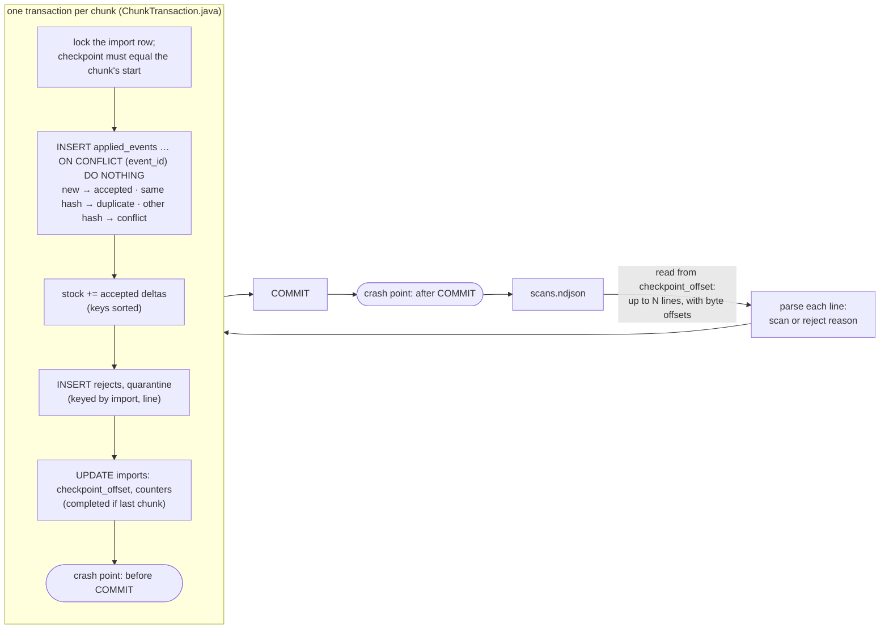

# backfill

Kill the worker halfway through a warehouse import. Restart it. Compare the resulting stock counts with an uninterrupted run.

[](https://github.com/AutumnTrace/backfill/actions/workflows/ci.yml)
[](LICENSE)

![Terminal output of scripts/crash-demo.sh. A reference import of 12,000 lines completes with 11,921 accepted, 50 duplicates, 1 conflict and 28 rejected. A second worker is halted before the COMMIT of the chunk holding lines 5,501 to 6,000 and exits with 137. Its status shows the checkpoint at byte 998,477, line 5,500, so the chunk was lost. A third is halted after that COMMIT, with the checkpoint at line 6,000. Both are restarted. Compare reports both as identical to the reference: 639 canonical lines, 600 stock rows totalling 15,879.](docs/media/crash-demo.png)

A Java 21 / Spring Boot CLI that replays synthetic barcode scans from a newline-delimited JSON file into an inventory projection in PostgreSQL. It reads the file in bounded chunks. Each chunk is one transaction, which:

- records the event ids it applied;
- updates stock;
- stores rejects and conflicts;
- moves the byte-offset checkpoint.

A worker can therefore die anywhere, by `kill -9` or by a deliberate halt just before or just after a COMMIT. The restarted worker finishes with exactly the inventory an uninterrupted run produces. The source is a file, so anyone can reproduce a crash at a specific line.

**Try it** (Docker):

```sh
git clone https://github.com/AutumnTrace/backfill && cd backfill
docker compose run --rm demo
```

Without Docker you need JDK 21 and PostgreSQL (developed against 18.4):

```sh
./mvnw -DskipTests package
BACKFILL_DB_URL=jdbc:postgresql://localhost:5432/backfill scripts/crash-demo.sh   # the database must exist
```

The scans, warehouses and SKUs are synthetic, generated from a seed by [`Generator.java`](src/main/java/io/github/autumntrace/backfill/dataset/Generator.java).

## A 60-second walkthrough

1. **Run the demo.** `scripts/crash-demo.sh` (or `docker compose run --rm demo`) imports [`data/scans-demo.ndjson`](data/scans-demo.ndjson) three times, each into its own schema. The file has 12,000 lines, 2.18 MB, and is generated with seed 20261126.
   - `reference` runs straight through.
   - `crash_before` is halted with `Runtime.halt(137)`, as `kill -9` would, after every statement of the chunk holding line 6,000 has run but before its COMMIT.
   - `crash_after` is halted right after that COMMIT.
2. **Read the two status blocks.** Before the COMMIT, the chunk's work and its checkpoint vanish together: the checkpoint is at line 5,500, byte 998,477. After the COMMIT, both are kept: line 6,000, byte 1,089,305. The status says *interrupted (no writer; resume it)*, because the dead worker's connection, and with it its writer lock, is gone.
3. **Restart and compare.** `resume 1` continues from the checkpoint. `compare` writes a canonical, sorted output of each schema to `out/` and compares them line by line: `identical: 639 canonical lines`, with the same 600 stock rows, the same 50 duplicates, the same quarantined conflict and the same 28 rejects at the same lines.
4. **Kill it for real.** `AFTER=2.2 scripts/kill-demo.sh` kills a worker at an arbitrary moment with `kill -9`, here 33% into a 200,000-line file. It resumes from byte 12,232,781, and compare again reports `identical`.
5. **Poke at it.**
   - Edit one byte of the file and try `resume`: it is refused, because the file's SHA-256 no longer matches.
   - Start a second worker on an import that is running: it is turned away.
   - `./backfill status` shows progress by byte offset.

## The transaction boundary



Everything a chunk changes, including the checkpoint and the counters that `status` prints, is written inside that one transaction. The whole transaction is in one file, [`ChunkTransaction.java`](src/main/java/io/github/autumntrace/backfill/importer/ChunkTransaction.java), and reads top to bottom in the order above.

**Why a crash cannot double-apply or lose a scan:**

- **Crash before COMMIT.** PostgreSQL discards the transaction. The checkpoint still points at the start of the chunk, so `resume` reads the same lines again.
- **Crash after COMMIT.** The checkpoint already points past the chunk, so `resume` starts with the next one.
- **Any other moment** (between chunks, mid-statement, while reading) is one of those two.
- **Two workers.** Step 1's row lock and checkpoint check stop a second writer that read the same checkpoint. A session advisory lock on (schema, import id) turns a second worker away before it starts. Even without either lock, `applied_events`' primary key keeps each scan applied at most once.

**What a larger chunk costs.** Fewer commits mean fewer WAL flushes, so throughput goes up, but only to a point (see below). In exchange:

- each transaction holds its row locks on `stock` for longer, so another writer touching the same SKUs waits longer;
- a crash redoes up to one whole chunk;
- the chunk's lines sit in memory, about 180 bytes each.

At 10,000 lines a chunk, the median transaction holds its locks for about 116 ms and a crash redoes up to 10,000 lines. That buys about 6% more throughput than 1,000 lines.

## Records: what counts as what

| Record | Effect | Where it goes |
| --- | --- | --- |
| A valid scan with a new event id | `stock(warehouse, sku) += delta` | `applied_events` (id, payload hash, import, line, byte offset) |
| The same event id with the same content | Nothing. "Same" is the hash of the parsed fields, so whitespace and key order don't matter. | counted as a duplicate |
| The same event id with different content | Nothing. The first payload stays applied, and the conflict is surfaced rather than resolved. | `quarantine`: the new payload verbatim, plus the first one's import, line, byte offset and hash |
| A malformed line | Nothing | `rejects`: line, byte offset, reason, raw text (first 1,000 chars) |

Rejects are one of:

- `malformed_json`;
- `missing_field:<name>`;
- `invalid_event_id` (a UUID is required);
- `invalid_warehouse` (`AAA-1`);
- `invalid_sku` (`SKU-12345`);
- `invalid_delta` (a non-zero integer, |delta| ≤ 10,000);
- `invalid_source` (device and a non-negative seq);
- `invalid_scanned_at` (ISO-8601 instant);
- `blank_line`;
- `line_too_long` (over 8,192 bytes).

The checkpoint is always at a line boundary: the byte offset after the last `\n` of a committed chunk, or end of file. A trailing `\r` is dropped, and the last line may end without `\n`.

An import records the file's path, size and SHA-256 when it starts. `resume` recomputes them and refuses on any difference, because a byte offset into another file means nothing. Starting a new `import` of a file whose earlier import is unfinished is refused too, with a pointer to `resume`; `--new` overrides that.

## Failure scenarios and the tests that pin them

All tests run on real PostgreSQL: Testcontainers `postgres:18.7-alpine` in CI, or a server you name. Each test works in its own schema.

| Scenario | What must happen | Test |
| --- | --- | --- |
| Crash before / after COMMIT, in the first, a middle and the final chunk | The resume ends identical to the reference, line for line | [`a_crash_then_a_resume_produces_the_reference_inventory`](src/test/java/io/github/autumntrace/backfill/CrashRecoveryTest.java#L59) (6 cases) |
| The real CLI halted in a child JVM, then resumed by another | Exit 137, status says interrupted, `compare` exits 0 | [`a_halted_worker_resumes_to_the_reference_result`](src/test/java/io/github/autumntrace/backfill/ProcessCrashTest.java#L43) |
| Two crashes in a row | Still converges | [`crashing_twice_in_a_row_still_converges`](src/test/java/io/github/autumntrace/backfill/CrashRecoveryTest.java#L79) |
| Chunk sizes 1, 7, 4,096, 100,000 | Identical results | [`chunk_size_does_not_change_the_result`](src/test/java/io/github/autumntrace/backfill/CrashRecoveryTest.java#L91) |
| A second worker while the first holds the import | Turned away (`WriterLock.Busy`, exit 3) | [`a_second_worker_on_the_same_import_is_turned_away…`](src/test/java/io/github/autumntrace/backfill/TwoWritersTest.java#L47) |
| Two workers resume at once, from separate pools | One completes; the result equals the reference | [`two_workers_resuming_at_once…`](src/test/java/io/github/autumntrace/backfill/TwoWritersTest.java#L63) |
| Eight transactions handed the same chunk at once, below the advisory lock | One commits, seven find the checkpoint moved | [`the_same_chunk_applied_twice_at_once_commits_once`](src/test/java/io/github/autumntrace/backfill/TwoWritersTest.java#L85) |
| Two imports of one file running together | Every scan applied once, stock equals one import | [`two_imports_of_one_file_running_together…`](src/test/java/io/github/autumntrace/backfill/TwoWritersTest.java#L111) |
| The final chunk is interrupted, and the file ends without `\n` | Resumed, last line applied once, checkpoint = file size | [`an_interrupted_final_chunk_without_a_trailing_newline_is_applied_once`](src/test/java/io/github/autumntrace/backfill/SourceFileTest.java#L76) |
| The file is appended to, has one byte changed, or is truncated before resume | Refused; the checkpoint is untouched | [`a_resume_against_a_modified_file_is_refused`](src/test/java/io/github/autumntrace/backfill/SourceFileTest.java#L57) |
| Identical duplicates and a conflicting one (chunk sizes 1, 2, 100) | Duplicates: no effect. Conflict: quarantined with both payload references | [`identical_duplicates_do_nothing_and_a_conflict_is_quarantined…`](src/test/java/io/github/autumntrace/backfill/RecordsTest.java#L27) |
| Twelve kinds of malformed line | The right reason, at the right line and byte offset | [`malformed_lines_are_rejected_with_a_reason_and_their_position`](src/test/java/io/github/autumntrace/backfill/RecordsTest.java#L72) |
| CRLF line endings, an empty file, multibyte UTF-8 offsets | Same results as LF, completes, byte-exact | [`SourceFileTest`](src/test/java/io/github/autumntrace/backfill/SourceFileTest.java), [`LineReaderTest`](src/test/java/io/github/autumntrace/backfill/LineReaderTest.java) |

I also checked the checkpoint guard by mutation. With the guard removed, `the_same_chunk_applied_twice_at_once_commits_once` fails.

## Measured

`./backfill bench --lines 200000 --seed 7 --chunk-sizes 100,1000,10000` was measured on Windows 11 with a Ryzen 7 9800X3D, PostgreSQL 18.4 running locally with default durability settings (`fsync` and `synchronous_commit` on), and Temurin 21.0.13.1. The input is a 200,000-line file of 36,618,913 bytes, seed 7, SHA-256 `f9e5b408e0bb…`.

Each size imports into a fresh schema, after one unmeasured warm-up import. "Chunk" is the wall time per chunk: read, parse and transaction, which is roughly how long the chunk's stock rows stay locked. Second of two runs (the first agreed within 3%):

| Chunk size | Chunks | Wall time | Lines/s | Median chunk | Slowest chunk | Most work redone after a crash |
| ---: | ---: | ---: | ---: | ---: | ---: | ---: |
| 100 | 2,000 | 3.69 s | 54,265 | 1.8 ms | 5.9 ms | 100 lines |
| 1,000 | 200 | 2.57 s | 77,897 | 12.6 ms | 19.2 ms | 1,000 lines |
| 10,000 | 20 | 2.41 s | 82,991 | 115.8 ms | 138.6 ms | 10,000 lines |

The demo default is 500. Past about 1,000 lines a chunk, throughput barely moves while lock time and redone work grow tenfold.

The test suite is 32 tests with about 23 s of test time on the same machine, against a local server.

## Commands

```text
backfill [--schema NAME] <command>

  import <file> [--chunk-size N] [--new] [--quiet]   import a scan log into the schema
  resume <import-id> [--file PATH] [--quiet]          continue an interrupted import from its checkpoint
  status [import-id]                                  imports, progress by byte offset, counts
  compare <schema-a> <schema-b> [--out DIR]           canonical output of two schemas, line by line
  export [--out FILE]                                 canonical output of this schema
  reset                                               drop and recreate this schema
  generate --out FILE [--lines N] [--seed N]          write a seeded synthetic scan log
  bench --lines N [--seed N] [--chunk-sizes 100,1000] import into fresh schemas, one per chunk size

  --crash-at-line N --crash-point before-commit|after-commit
```

Exit codes:

- 0: done;
- 1: `compare` found a difference;
- 2: usage;
- 3: refused (the source changed, another writer is active, the import is unfinished);
- 137: a controlled crash.

| Task | Command |
| --- | --- |
| Build | `./mvnw -DskipTests package` (then `./backfill …`, or `backfill.cmd …` on Windows) |
| Tests (Docker for Testcontainers) | `./mvnw verify` |
| Tests on a server you already run | `BACKFILL_TEST_DB_URL=jdbc:postgresql://localhost:5432/backfill ./mvnw verify` |
| The crash demo | `scripts/crash-demo.sh` (`LINE=`, `CHUNK=`, `FILE=` to vary it) |
| The kill -9 demo | `AFTER=2 scripts/kill-demo.sh` |
| Reset a schema | `./backfill --schema reference reset` |
| Regenerate the demo file | `./backfill generate --out data/scans-demo.ndjson --lines 12000 --seed 20261126` (a test checks it is byte-identical) |

Connection settings are `BACKFILL_DB_URL`, `BACKFILL_DB_USER` and `BACKFILL_DB_PASSWORD`, defaulting to `jdbc:postgresql://localhost:5432/backfill`, `postgres` and `postgres`. Compose publishes its database on `localhost:55432`.

## Three files worth reading

1. [`importer/ChunkTransaction.java`](src/main/java/io/github/autumntrace/backfill/importer/ChunkTransaction.java): the transaction, all of it, in order.
2. [`importer/ImportRunner.java`](src/main/java/io/github/autumntrace/backfill/importer/ImportRunner.java) with [`importer/WriterLock.java`](src/main/java/io/github/autumntrace/backfill/importer/WriterLock.java): source-digest checks, one writer per import, the loop from checkpoint to end of file.
3. [`CrashRecoveryTest.java`](src/test/java/io/github/autumntrace/backfill/CrashRecoveryTest.java): how a crash on either side of a COMMIT is staged and checked against a reference run.

## Tradeoff, limitation, next step

**Tradeoff.** Exactly-once comes from a table of applied event ids, kept forever and checked on every insert. That is simple to reason about and survives any crash. The cost is that the table grows with every event ever imported, and every chunk pays an index lookup per scan. A projection that could be rebuilt from scratch on each run would not need it.

**Known limitation.** The policy for a conflicting duplicate is "first seen stays applied, later ones are quarantined". So the result depends on file order, and nothing yet resolves a quarantined conflict. Someone has to look at `quarantine` and decide.

**Next step.** A `resolve <event-id> --keep first|second` command that applies the compensating stock change and closes the quarantine row in one transaction, written the same way as a chunk. Without it, the quarantine only grows.

## Scope

- One source format, NDJSON, and one writer per import.
- Kafka and distributed scheduling are out of scope. The file is the replayable source.

## License

[MIT](LICENSE)
